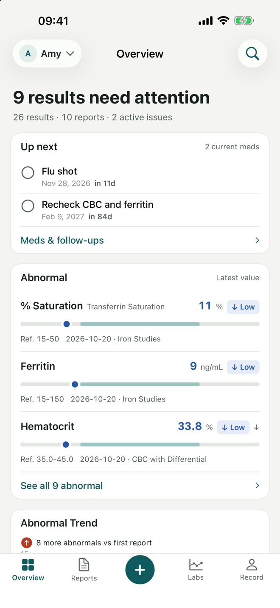
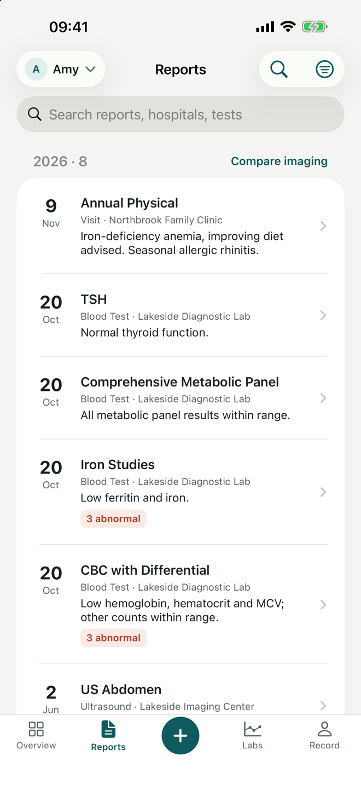
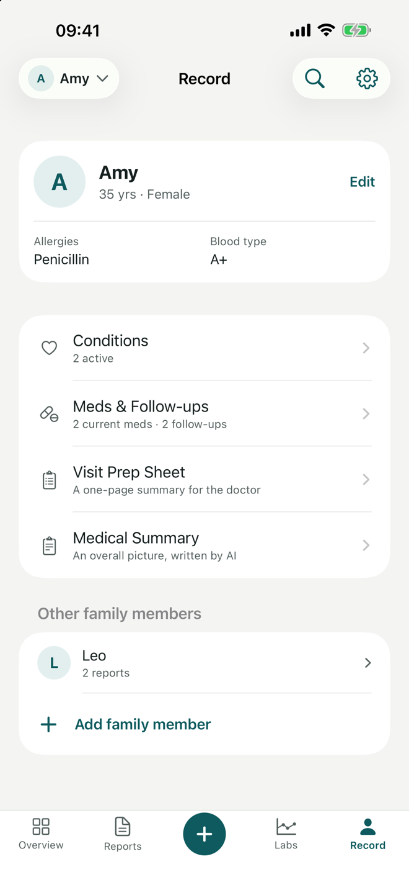
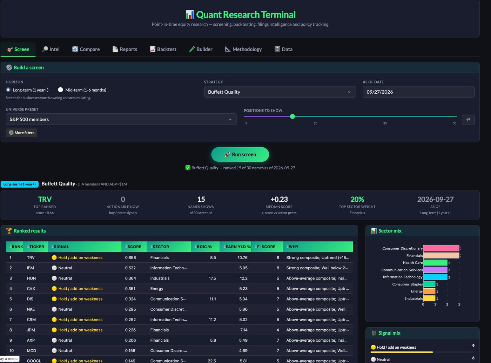
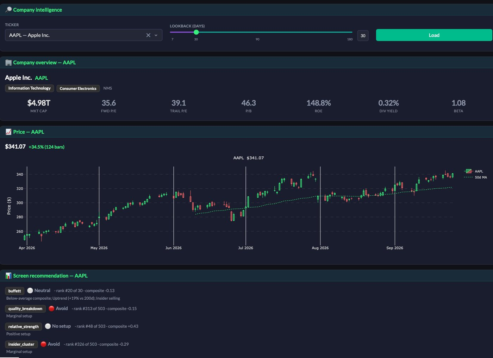

# Eylon Liu — Project Portfolio

Full-stack and mobile developer with experience across iOS (SwiftUI), web (React, TypeScript), and Python. I enjoy building tools that solve real problems — from AI-powered health record management to quantitative finance pipelines.

This repo showcases selected projects. Some are open source and linked below; for the rest, source is available upon request.

---

## FamilyVitals

**iPhone app that turns a family's lab reports into results you can read at a glance — on the device, with no account.**

**[Product page](https://eylon-liu.github.io/portfolio/familyvitals/)** · [Support](https://eylon-liu.github.io/portfolio/familyvitals/support.html) · [Privacy policy](https://eylon-liu.github.io/portfolio/familyvitals/privacy.html) · Status: version 1.4 in App Store review prep, launching in the US first (beta on TestFlight)

Photograph a report or pick a PDF. FamilyVitals reads dates, the hospital and every lab value, draws each result against the reference range printed on its own report, and keeps one record per family member. Over time each report extends the trends, and the app leads with what needs attention and when the next follow-up is.

  
  &nbsp;&nbsp;
  
  &nbsp;&nbsp;
  

Screenshots use a fictional demo profile, not real medical records.

**What it does:**
- **Reads reports on the phone.** Apple Vision OCR plus a rule-based parser extract dates, hospitals and lab tables from photos, scans and PDFs — free and offline, no API key. Batch import, and a review step before anything is saved.
- **Shows how far out of range, not just whether.** Range bars place each value on its report's own reference range; high and low carry an arrow as well as a color, and normal values stay uncolored.
- **Labs tab and trends.** Every test the person has had (out of range / starred / all); each opens a chart and every past result linked back to its source report.
- **Overview, meds and follow-ups.** Opens on what needs attention; medication list, follow-up reminders and a one-page visit prep sheet for the doctor.
- **The whole family.** Separate records per person, switchable from any tab; global search across reports, results, hospitals and medications; side-by-side comparison of imaging reports.
- **Optional AI reading** with the user's own key (Google Gemini, ZhiPu GLM, DeepSeek) for complex layouts, report explanations and a medical summary.
- Light and dark appearance, fully bilingual (Chinese / English).

**Privacy by design:**
- No server, no account, no analytics or ads. Data lives in Core Data on the device, with an optional Face ID / passcode lock and JSON backup export.
- AI requests go straight from the phone to the provider the user picked. Before the first request to each provider the app asks for consent (App Store Guideline 5.1.2(i)), and the network layer refuses to send without it.
- Names, ages, ID and record numbers, phones, addresses and e-mails are redacted on the device before any text leaves the phone; page images sent to vision models are masked; original files are never uploaded.
- Privacy manifest and App Store privacy label declare exactly that.

**Technical highlights:**
- SwiftUI + Core Data (five model versions with lightweight migration), iOS 16+, XcodeGen
- A small design system built from a design handoff: tokens for color, type, spacing and radius; range bars, step scales and status chips shared across screens
- Three AI providers behind one client, with automatic failover, batch-to-single fallback on token overflow, and chunked multi-pass extraction for long reports with deduplication-aware merging
- 2,000+ unit tests plus source-rule checks (e.g. every save listener is scoped to its own context), run in GitHub Actions
- API keys in the iOS Keychain; portrait-only, iPhone-only build ready for App Store submission

---

## Quant Research Terminal

**Local web app for mid- and long-horizon equity research — screening, backtesting and filings intelligence.**

Stores everything it fetches, so a screen can be re-run *as of any past date* and a strategy
backtested without using information that did not exist yet. Runs entirely on your machine,
on free data sources, with no API keys required.

  

<em>Screen tab: a quality strategy run over the S&amp;P 500 — ranked results, sector mix, signal breakdown</em>

  

<em>Intel tab: company overview, price chart, and how each strategy scores the name</em>

**What it does:**
- Fourteen strategies across two horizons — quality/value/compounder screens for the long term, momentum/breakout/mean-reversion for the mid term
- Position sizes implied by a risk budget and stop distance, expressed as a share of portfolio
- Reports rank IC next to returns, so it's visible when outperformance came from a few names rather than from the ranking actually working

**Technical highlights:**
- Point-in-time correctness throughout: every SEC fact is gated on its filing date, so a screen never sees a figure before it was public
- Survivorship bias handled — index membership is reconstructed historically from page revisions and cross-checked against the ETF's own N-PORT filings
- XBRL duration disambiguation (quarterly vs. year-to-date facts sharing an end date), and adjusted/unadjusted prices never mixed
- Per-ticker staleness tracking and a store-versioned factor cache: a cold run takes ~76s, a repeat run with nothing stale ~0.2s

**Stack:** Python, SQLite, SEC EDGAR XBRL, Dash. Optional LLM layer for natural-language interpretation.

**Source:** [github.com/Eylon-Liu/trading](https://github.com/Eylon-Liu/trading)

---

## Personal Website

**Interactive editorial-atlas personal site.** World map of cities lived and traveled, work timeline, life chapters, and photography.

**Live:** [eylon-liu.vercel.app](https://eylon-liu.vercel.app)

**Technical highlights:**
- Hand-plotted dot-matrix world map drawn as inline SVG — no map library or tile service, so the whole site is one static file with no runtime dependencies beyond React
- Animated great-circle journey between cities, with per-city detail cards and passport stamps
- Justified photo gallery: frames take each photo's own aspect ratio, so nothing is cropped
- Build step precompiles the JSX and ships React's production build, cutting ~4 MB of JavaScript off the page

**Stack:** React (JSX), inline SVG, static deploy on Vercel with a single-source build.

---

## Technical Skills

| Area | Technologies |
|---|---|
| **Mobile** | SwiftUI, CoreData, UIKit, XcodeGen, TestFlight |
| **Frontend** | React, TypeScript, JavaScript, HTML/CSS, SVG |
| **Backend** | Python, Flask, Node.js, SQLite |
| **AI/ML** | REST API integrations (Gemini, DeepSeek, ZhiPu GLM, Qwen), prompt engineering, vision models, structured extraction |
| **Finance** | Fixed income analysis, FX risk, algorithmic trading, quantitative modeling |
| **Tools** | Git, Xcode, Vercel, Jupyter |

---

## Contact

- GitHub: [Eylon-Liu](https://github.com/Eylon-Liu)
- Website: [eylon-liu.vercel.app](https://eylon-liu.vercel.app)
