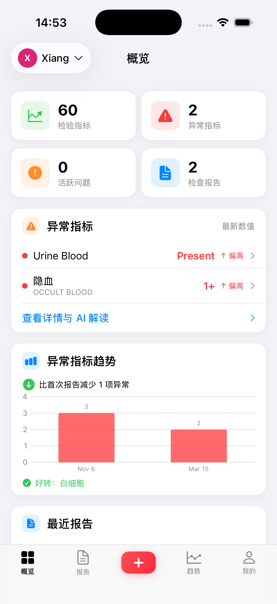
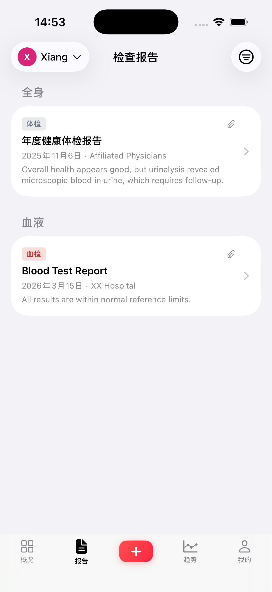
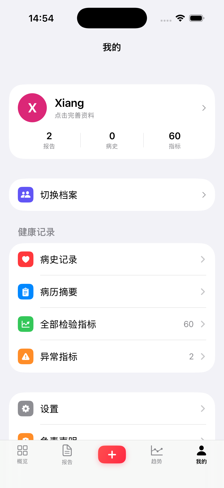
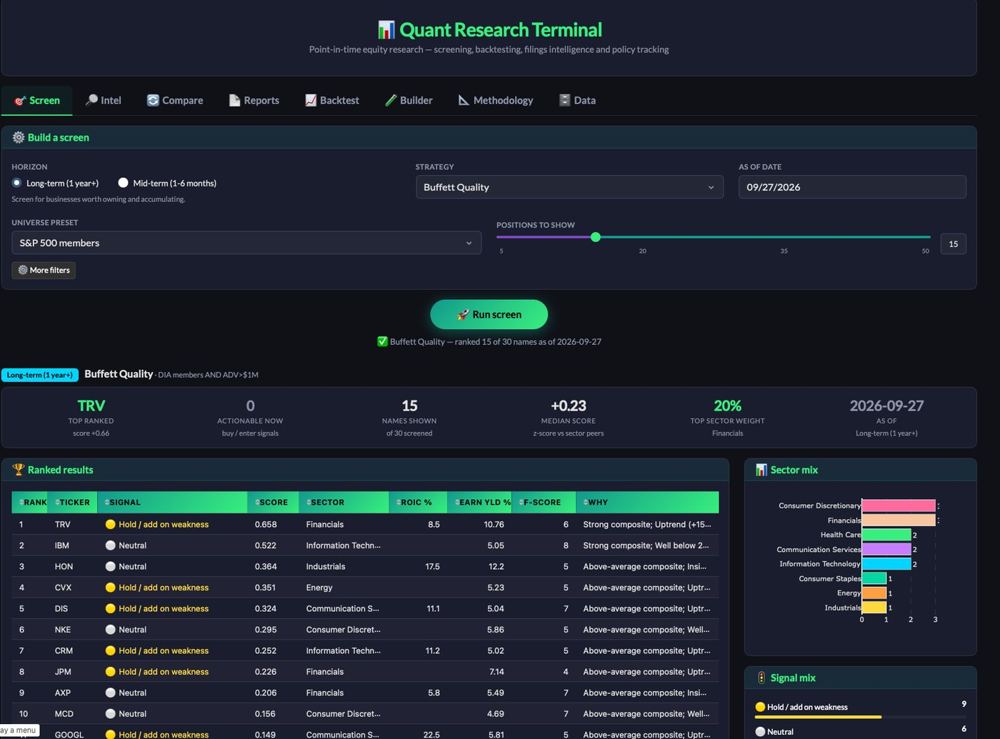
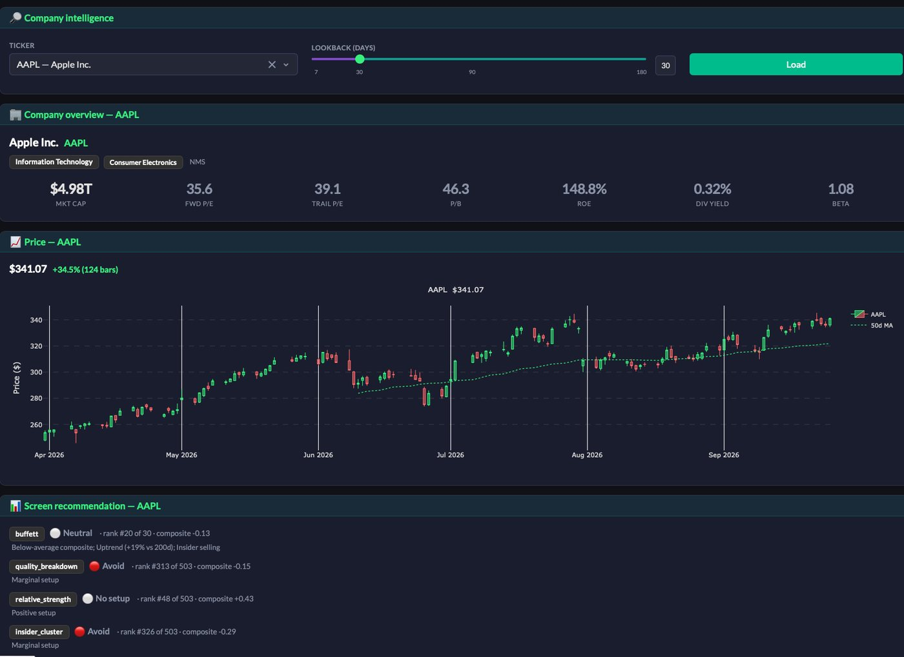

# Eylon Liu — Project Portfolio

Full-stack and mobile developer with experience across iOS (SwiftUI), web (React, TypeScript), and Python. I enjoy building tools that solve real problems — from AI-powered health record management to quantitative finance pipelines.

This repo showcases selected projects. Some are open source and linked below; for the rest, source is available upon request.

---

## FamilyVitals

**iOS app for managing personal and family health records with AI-powered data extraction.**

Upload a medical report as a PDF or photo, and the app automatically extracts lab results, dates, hospital names, and reference ranges using AI vision models. Designed for families who want to track health trends over time without manual data entry.

  
  &nbsp;&nbsp;
  
  &nbsp;&nbsp;
  

**What it does:**
- Extracts structured data from medical reports via AI (Gemini, Qwen, DeepSeek) — handles PDFs, photos, and batch imports
- Tracks 60+ lab indicators across reports, flags abnormal values, and charts trends over time
- Supports multiple family member profiles with independent data
- Fully bilingual (Chinese/English) with on-device data storage — no account or server needed

**Technical highlights:**
- SwiftUI + CoreData, iOS 16+
- Three AI provider integrations with automatic failover and batch-to-single fallback on token overflow
- Multi-pass text extraction for long reports (chunked processing with deduplication-aware merging)
- Configurable API endpoints for Alibaba Cloud workspace keys
- XcodeGen-based project configuration
- Published on TestFlight

---

## Quant Research Terminal

**Local web app for mid- and long-horizon equity research — screening, backtesting and filings intelligence.**

Stores everything it fetches, so a screen can be re-run *as of any past date* and a strategy
backtested without using information that did not exist yet. Runs entirely on your machine,
on free data sources, with no API keys required.

  

<em>Screen tab: a quality strategy run over the S&amp;P 500 — ranked results, sector mix, signal breakdown</em>

  

<em>Intel tab: company overview, price chart, and how each strategy scores the name</em>

**What it does:**
- Fourteen strategies across two horizons — quality/value/compounder screens for the long term, momentum/breakout/mean-reversion for the mid term
- Position sizes implied by a risk budget and stop distance, expressed as a share of portfolio
- Reports rank IC next to returns, so it's visible when outperformance came from a few names rather than from the ranking actually working

**Technical highlights:**
- Point-in-time correctness throughout: every SEC fact is gated on its filing date, so a screen never sees a figure before it was public
- Survivorship bias handled — index membership is reconstructed historically from page revisions and cross-checked against the ETF's own N-PORT filings
- XBRL duration disambiguation (quarterly vs. year-to-date facts sharing an end date), and adjusted/unadjusted prices never mixed
- Per-ticker staleness tracking and a store-versioned factor cache: a cold run takes ~76s, a repeat run with nothing stale ~0.2s

**Stack:** Python, SQLite, SEC EDGAR XBRL, Dash. Optional LLM layer for natural-language interpretation.

**Source:** [github.com/Eylon-Liu/trading](https://github.com/Eylon-Liu/trading)

---

## Personal Website

**Interactive editorial-atlas personal site.** World map of cities lived and traveled, work timeline, life chapters, and photography.

**Live:** [eylon-liu.vercel.app](https://eylon-liu.vercel.app)

**Technical highlights:**
- Hand-plotted dot-matrix world map drawn as inline SVG — no map library or tile service, so the whole site is one static file with no runtime dependencies beyond React
- Animated great-circle journey between cities, with per-city detail cards and passport stamps
- Justified photo gallery: frames take each photo's own aspect ratio, so nothing is cropped
- Build step precompiles the JSX and ships React's production build, cutting ~4 MB of JavaScript off the page

**Stack:** React (JSX), inline SVG, static deploy on Vercel with a single-source build.

---

## OIS AI — AI Calendar & Task Manager

**Web app that uses AI to intelligently schedule tasks around your real calendar.**

Connects to your calendar, understands your working hours and energy patterns, then allocates tasks to optimal time slots. Includes routine management, break optimization, and productivity analytics.

**Stack:** Python (Flask), DeepSeek API, SQLite. Full-featured dashboard with analytics and AI chat interface.

---

## Contour

**A reflective journaling app — understand what shaped you.**

Interactive journaling experience that helps users explore personal history and recurring life patterns through guided prompts and timeline visualization.

**Stack:** React Native, JavaScript.

---

## Technical Skills

| Area | Technologies |
|---|---|
| **Mobile** | SwiftUI, CoreData, UIKit, XcodeGen, TestFlight |
| **Frontend** | React, TypeScript, JavaScript, HTML/CSS, SVG |
| **Backend** | Python, Flask, Node.js, SQLite |
| **AI/ML** | REST API integrations (Gemini, DeepSeek, Qwen), prompt engineering, vision models, structured extraction |
| **Finance** | Fixed income analysis, FX risk, algorithmic trading, quantitative modeling |
| **Tools** | Git, Xcode, Vercel, Jupyter |

---

## Contact

- GitHub: [Eylon-Liu](https://github.com/Eylon-Liu)
- Website: [eylon-liu.vercel.app](https://eylon-liu.vercel.app)
